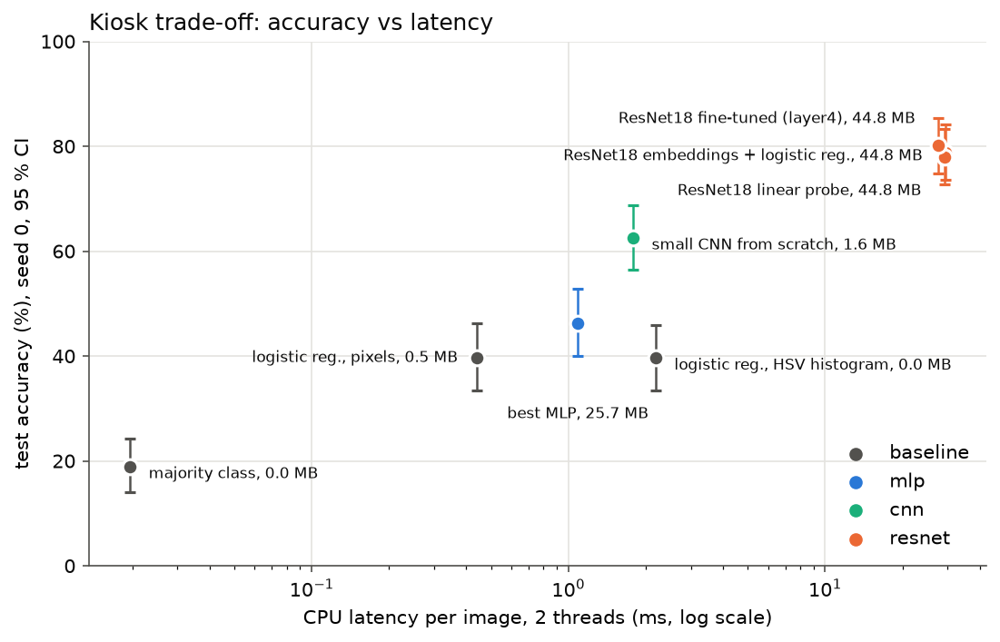

# Question 1, genre: summary of results and recommendation

**Task:** recognise the genre of a painting among 5 (cityscape, landscape, portrait, religious painting, still
life) for the museum guide.
**Data:** `data/wikiart_genre5` (128 px, for the MLP, the small CNN and the baselines) and
`data/wikiart_genre5_224` (same paintings, 224 px, for ResNet). 1 500 images, 300 per genre, at most 30 per
named painter (`--max-per-artist 30`, see the README: with the default 50, Claude Monet alone was 17 % of the
cityscapes and broke the stratified split). 48 % "Unknown Artist" (93 % on the style subset): the artist grouping
of the split protects much more here.
**Protocol:** train / val / test = 1 051 / 222 / 227 images (70/15/15), stratified by genre and grouped by artist
(`splits/wikiart_genre5.csv`, checked by `tests/test_splits_no_leak.py`). Learning rates measured by LR range
test for every config; every choice (version, hyperparameter, fine-tuning level, C) made on **validation**, by the
lowest mean val loss over 3 seeds (val accuracy for the logistic regressions). The **test set was used once**
(`scripts/evaluate.py`). Every run is in MLflow with its git commit.

---

## 1. Final answer (test set, single pass)

| Model | Test accuracy [95 % CI] | Macro-F1 | CPU latency, 1 image, 2 threads | Size |
|---|---|---|---|---|
| Majority class | 18.9 [14.1, 24.2] | 6.4 | 0.02 ms | 0 MB |
| Logistic regression on pixels | 39.6 [33.5, 46.3] | 38.9 | 0.4 ms | 0.5 MB |
| Logistic regression on HSV colour histogram | 39.6 [33.5, 45.8] | 39.8 | 2.2 ms | 0.01 MB |
| Best MLP (v5, batch 32) | 46.3 [40.1, 52.9] (3 seeds: 45.2 ± 2.2) | 46.0 | 1.1 ms | 25.7 MB |
| **Small CNN from scratch** (batch 16) | 62.6 [56.4, 68.7] (3 seeds: 60.6 ± 2.3) | 62.3 | 1.8 ms | **1.6 MB** |
| **ResNet18 frozen + logistic regression on its embeddings** | 78.9 [73.6, 84.1] | 78.5 | 29 ms | 44.8 MB |
| ResNet18 linear probe | 78.0 [72.7, 83.3] (3 seeds: 77.5 ± 0.8) | 77.2 | 29 ms | 44.8 MB |
| ResNet18 fine-tuned (layer4 + head) | 80.2 [74.9, 85.5] (3 seeds: 79.6 ± 2.3) | 79.8 | 28 ms | 44.8 MB |

Seed 0 with its 95 % bootstrap interval (2 000 resamples of the 227 test images). Paired bootstrap (same
resampled images for both models):

| Comparison | Difference | 95 % CI | Conclusion |
|---|---|---|---|
| CNN from scratch − MLP | **+16.3 pts** | [+8.8, +23.3] | convolutions clearly beat the fully connected network, with 16× fewer parameters |
| ResNet fine-tuned − CNN from scratch | **+17.6 pts** | [+10.1, +24.7] | ImageNet pre-training adds as much again |
| ResNet fine-tuned − HSV logistic regression | +40.5 pts | [+32.2, +48.5] | the pre-trained CNN is clearly better than the classical model |
| MLP − HSV logistic regression | +6.6 pts | [−1.8, +15.0] | the MLP is not significantly better than a classical model |
| ResNet fine-tuned − linear probe | +2.2 pts | [−1.8, +5.7] | **not distinguishable** |
| ResNet fine-tuned − embeddings + logistic regression | +1.3 pts | [−2.6, +5.3] | **not distinguishable** |



---

## 2. Recommendation to the director

**Same answer as for the styles: yes, a neural network, but a pre-trained one used as a frozen feature
extractor: ResNet18 embeddings + a logistic regression.**

- **Accuracy:** 79 % on the test set, against 40 % for the classical models (pixels or colour histogram). The gap
  (~40 points) is far larger than the uncertainty (± 5–6 points with 227 test images).
- **Cost on the kiosk:** ~30 ms per photo on 2 CPU threads on this laptop (111 ms on the machine of the style
  evaluation: the kiosk CPU must be measured, but even 0.1 s is acceptable), 45 MB.
- **Cost for the team:** no network training: the ResNet is downloaded pre-trained, only a logistic regression is
  fitted on 512 numbers per image. Adding a genre = adding images and refitting.
- **Why not fine-tuning?** 1–2 points better on test, not distinguishable (interval contains 0), for a GPU and a
  training loop to maintain.
- **And the small CNN?** It is the interesting middle ground for a very constrained device: 63 % for 1.6 MB and
  2 ms. But 16 points below the frozen ResNet; not worth it while 45 MB and 30 ms are affordable.

---

## 3. What each deliverable showed on the genres

**Deliverable 1, MLP (`tables/wikiart_genre5_ablation.md`).** Ablation v0 → v6, 3 seeds each, LRs re-measured on
genre. Validation accuracy 41–45 % whatever is added, except **v2 (BatchNorm + 2nd layer): 38.7 %**. The MLP beats
the logistic regression on the same pixels by 4–5 points (it did not on the styles).

**Deliverable 2, monitoring and diagnosis.**
- *v2 overfits in one epoch.* MLflow curves (seed 0): train accuracy 44 % → 96 % in 8 epochs while the val loss
  rises from epoch 2 (1.35 → 1.82). BatchNorm allows a 5× larger LR, the 6.4 M-parameter network memorises 1 051
  images, early stopping keeps epoch 1. Dropout slows the memorisation (v3), **augmentation stops it** (v5: train
  accuracy 49 % at epoch 8, train − val gap 5 points): random crops and flips do not change the genre, every
  epoch sees new examples.
- *The small CNN under-fits.* At its kept epoch it is at 61–64 % on train vs 52–60 % on val: it lacks capacity or
  data, not regularisation. Consistent with the +5 points it gains at 128 px (same parameters, more detail).
- *Hyperparameter sweeps (`tables/wikiart_genre5_sweeps.md`).* One hyperparameter at a time, 3 seeds each:
  batch size 16–128 (LR re-measured for each size: the two are coupled) and crop scale 0.4–1.0 change nothing
  beyond noise, so the standard values are justified by measurement. The 40 epochs of the cosine schedule were
  too short (2 of 3 seeds kept epoch 39 of 40; at 60–80 epochs the best epoch moves away from the end).

**Deliverable 3, ResNet18 (`tables/wikiart_genre5_resnet.md`).** Linear probe 82.4 ± 0.9 %, partial fine-tuning
88.1 ± 0.9 %, full fine-tuning 85.9 ± 0.3 % on validation. Full fine-tuning overfits from epoch 3: with 1 051
images, unfreezing 11 M parameters costs more than it brings. Partial (selected by val loss) is the best level.

**The painting's orientation** (`metadata.csv`: original width and height, erased by the square crop): 89 % of
portraits are vertical vs 21 % of landscapes. Alone, log(height / width) reaches 36 % val accuracy but predicts
only "vertical → portrait, horizontal → cityscape" (macro-F1 24 %). It adds ~6 points to the HSV histogram and
nothing to the pixels. It is **not used by the final models**: at the kiosk, a phone photo gives the painting's
format only if the visitor frames it, so using it would be a shortcut unavailable in production.

---

## 4. Limitations

- **Validation is optimistic for ResNet:** val 88.1 % → test 79.6 % for the fine-tuned model, 82.4 → 77.5 % for the
  probe, 83.3 → 78.9 % for the embeddings; the MLP and the CNN do not drop (44.6 → 45.2 %, 57.4 → 60.6 %). Part of
  it is selection on a small validation set (222 images, ± 6 points); part may be a harder test split. This is
  why only test numbers are reported in section 1.
- **Main confusion: cityscape → landscape** (17 of 43 test cityscapes for the fine-tuned ResNet): towns painted
  within landscapes are genuinely ambiguous. Then portrait → religious painting (7 of 45).
- **Small test set:** 227 images, every accuracy is ± 5–6 points.
- **Model selection among many variants:** the MLP and CNN candidates were picked among the ablation and sweep
  variants by val loss (mlp_v5-bs32, cnn-bs16); with many candidates, the winner's val score is optimistic, its
  test score is not.
- **Photos at the kiosk are not WikiArt scans** (reflections, angles, frames): a test on real visitor photos is
  needed before deployment.
- **Latency** measured on this laptop, 2 threads, from images already at 224 px.

---

## 5. Additions on the styles (validation only)

The single test pass of the styles was run before these models existed; re-running it would need the original
checkpoints and MLflow database. These results are validation only (3 seeds, 222 images):

| Model | Style val accuracy | Note |
|---|---|---|
| Logistic regression, pixels / HSV (re-run) | 33.3 / 50.9 % | identical to the first run: the pipeline reproduces across machines |
| Logistic regression, orientation alone | 25.2 % | orientation says nothing about the style (macro-F1 15 %) |
| MLP v6 (40 epochs, first run) | 41.7 ± 1.6 % | val loss 1.364 |
| MLP v6, 60 epochs | 42.3 ± 2.0 % | val loss 1.344: the longer cosine helps the loss slightly, accuracy within noise |
| **Small CNN from scratch, 64 px** | **61.7 ± 0.5 %** | +20 points over the MLP, +11 over the HSV histogram |
| Small CNN from scratch, 128 px | 58.3 ± 2.6 % | no gain on styles (best epochs 11–15: overfits sooner), unlike genres |
| ResNet18 (first run) | 80.6–85.1 % | see `wikiart_style5_summary.md` |

The same ladder holds on both tasks: classical model < MLP < CNN from scratch < pre-trained ResNet.

---

## 6. Reproduce

See the README (subset commands with `--max-per-artist 30`, then):

```bash
uv run python scripts/run_baselines.py --data-dir data/wikiart_genre5
uv run python scripts/train.py --config configs/genre/mlp_v5.yaml --seeds 0 1 2      # any config in configs/genre/
uv run python scripts/train.py --config configs/genre/cnn.yaml --seeds 0 1 2
uv run python scripts/train.py --config configs/genre/resnet_partial.yaml --seeds 0 1 2
uv run python scripts/resnet_embeddings.py --subset wikiart_genre5
uv run python scripts/ablation_table.py --subset wikiart_genre5
uv run python scripts/sweep_table.py --subset wikiart_genre5
uv run python scripts/evaluate.py --subset wikiart_genre5      # the single test pass (refuses to run twice)
uv run python scripts/final_report.py --subset wikiart_genre5
```
