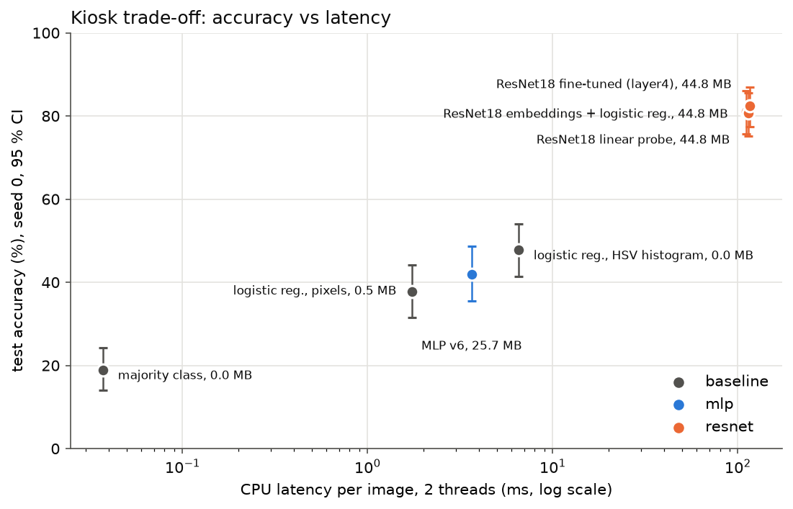

# Question 1, style: summary of results and recommendation

**Task:** recognise the style of a painting among 5 (Baroque, Cubism, Impressionism, Pop Art, Ukiyo-e) for the museum guide.
**Data:** `data/wikiart_style5` (128 px, for the MLP and baselines) and `data/wikiart_style5_224` (same paintings, 224 px, for ResNet). 1 500 images, 300 per style.
**Protocol:** train / val / test = 1 056 / 222 / 222 images (70/15/15), stratified by style and grouped by artist (`splits/wikiart_style5.csv`, checked by `tests/test_splits_no_leak.py`). Every choice (learning rates, regularisation, versions, fine-tuning level, C of the logistic regressions) was made on **validation**. The **test set was used once**, at the end (`scripts/evaluate.py` refuses to run twice). Every run is in MLflow (`mlflow.db`) with its git commit.

---

## 1. Final answer (test set, single pass)

| Model | Test accuracy [95 % CI] | Macro-F1 | CPU latency, 1 image, 2 threads | Size |
|---|---|---|---|---|
| Majority class | 18.9 [14.0, 24.3] | 6.4 | 0.04 ms | 0 MB |
| Logistic regression on pixels | 37.8 [31.5, 44.1] | 36.6 | 1.7 ms | 0.5 MB |
| **Logistic regression on HSV colour histogram** (the "simple classical model") | 47.7 [41.4, 54.1] | 46.9 | 6.5 ms | 0.01 MB |
| Best MLP (v6) | 41.9 [35.6, 48.6] (3 seeds: 40.7 ± 1.1) | 40.1 | 3.7 ms | 25.7 MB |
| **ResNet18 frozen + logistic regression on its embeddings** | **81.1 [75.7, 86.0]** | 81.1 | 111 ms | 44.8 MB |
| ResNet18 linear probe | 80.6 [75.2, 85.6] (3 seeds: 79.4 ± 2.5) | 80.6 | 114 ms | 44.8 MB |
| ResNet18 fine-tuned (layer4 + head) | 82.4 [77.5, 86.9] (3 seeds: 84.1 ± 2.5) | 82.3 | 116 ms | 44.8 MB |

Seed 0 is reported with its 95 % bootstrap interval (2 000 resamples of the 222 test images); "3 seeds" is mean ± std of the three trained models. Paired bootstrap (same resampled images for both models):

| Comparison | Difference | 95 % CI | Conclusion |
|---|---|---|---|
| ResNet fine-tuned − HSV logistic regression | **+34.7 pts** | [+27.5, +41.9] | the pre-trained CNN is clearly better |
| ResNet fine-tuned − MLP | +40.5 pts | [+33.3, +47.7] | clearly better |
| MLP − HSV logistic regression | −5.9 pts | [−13.1, +0.9] | the MLP is not better than the classical model (slightly worse, not significant) |
| ResNet fine-tuned − ResNet linear probe | +1.8 pts | [−2.7, +5.9] | **not distinguishable** |
| ResNet fine-tuned − ResNet embeddings + logistic regression | +1.4 pts | [−3.2, +5.9] | **not distinguishable** |



---

## 2. Recommendation to the director

**Yes, a neural network is worth it, but a pre-trained one, used as a frozen feature extractor: ResNet18 embeddings + a logistic regression.**

- **Accuracy:** about 81 % on the test set, against 48 % for the best classical model (colour histogram). The gap (+33 to +35 points) is far larger than the uncertainty (± 6 points with 222 test images).
- **Cost on the kiosk:** about **0.11 s per photo** on 2 CPU threads, and a **45 MB** model: compatible with a modest CPU, no GPU needed.
- **Cost for the team:** no network training at all. The ResNet is downloaded pre-trained; only a logistic regression is fitted on 512 numbers per image (extracting the features of the 1 056 training images and fitting take about a minute on a CPU). Adding a style = adding images and refitting the regression.
- **Why not fine-tuning?** It is 1 to 2 points better on validation and test, which the test set **cannot distinguish** from the frozen model (intervals include 0), while it requires a GPU, a training loop to maintain and more risk of overfitting (best epoch 3–4). It is the upgrade path if the collection grows.
- **Why not our own MLP?** It does not beat the colour histogram: a fully connected network on raw pixels ignores the spatial structure of the image (Phase 3).

---

## 3. What each deliverable showed

**Deliverable 1, feed-forward network (MLP), Phase 3.** Ablation v0 → v6, one change per version, 3 seeds each (`tables/wikiart_style5_ablation.md`, `figures/wikiart_style5/ablation.png`). Validation accuracy stays at 39–43 % whatever we add (optimizer, BatchNorm, dropout, weight decay, augmentation, cosine schedule, label smoothing), while the train − val gap falls from 26 to 10 points: overfitting is fixed, accuracy does not follow. The limit is the representation (12 288 independent pixels, no notion of neighbourhood), not the training.

**Deliverable 2, monitoring and failure diagnosis, Phase 4.** Gradient norm per layer, update/weight ratio, activations and dead ReLUs logged at every epoch. 8 failures provoked on purpose, each with symptom, evidence and fix (`tables/wikiart_style5_failures.md`, `figures/wikiart_style5/failures/`). Example: 8 sigmoid layers without BatchNorm, the gradient is divided by ~400 000 between the output and the first layer and the loss stays at ln 5; with ReLU + Kaiming + BatchNorm the same depth learns.

**Deliverable 3, pre-trained ResNet18, Phase 5.** Linear probe 80.6 ± 1.2 %, partial fine-tuning 84.5 ± 1.4 %, full fine-tuning 85.1 ± 0.5 % on validation (`tables/wikiart_style5_resnet.md`). Frozen ImageNet features already explain almost everything; partial fine-tuning (selected by validation loss) adds a few points.

---

## 4. Limitations

- **Small test set:** 222 images, so every accuracy is ± 6 points. Models less than ~5 points apart cannot be ranked.
- **Artist leakage cannot be fully excluded:** 93 % of the images are "Unknown Artist" (100 % of Impressionism and Pop Art), so grouping by artist protects little. A deliberately ungrouped split gives +1.7 points on validation (within noise).
- **Photos at the kiosk are not WikiArt scans:** reflections, angles, frames and lighting will lower accuracy. A test on real visitor photos is needed before deployment.
- **Latency** is measured on this machine's CPU with 2 threads, from a 224 px image; the kiosk CPU and the resizing of a camera photo will add time.
- **Seed variance:** the fine-tuned ResNet varies by ± 2.5 points across seeds on the test set (82.4 to 86.9 %), a reminder that one run is not a result.

---

## 5. Reproduce

```bash
uv sync
uv run pytest -q                                                    # 78 tests
uv run python scripts/run_baselines.py --data-dir data/wikiart_style5
uv run python scripts/train.py --config configs/style/mlp_v6.yaml --seeds 0 1 2      # any config in configs/style/
uv run python scripts/lr_range_test.py --config configs/style/mlp_v2.yaml
uv run python scripts/train.py --config configs/style/failures/deep_sigmoid.yaml      # one provoked failure
uv run python scripts/train.py --config configs/style/resnet_partial.yaml --seeds 0 1 2
uv run python scripts/resnet_embeddings.py
uv run python scripts/ablation_table.py      # Phase 3 and 5 tables
uv run python scripts/failure_figures.py     # Phase 4 figures
uv run python scripts/evaluate.py            # the single test pass (refuses to run twice)
uv run python scripts/final_report.py
uv run mlflow ui --backend-store-uri sqlite:///mlflow.db                              # browse every run
```
